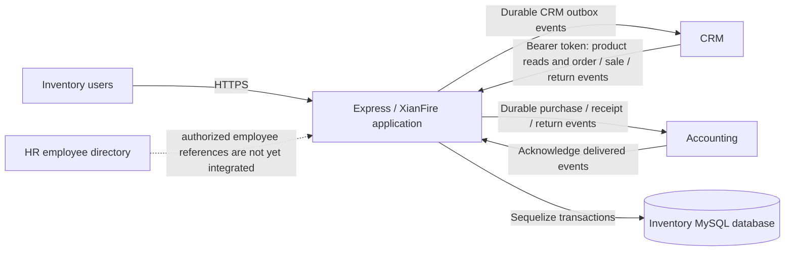
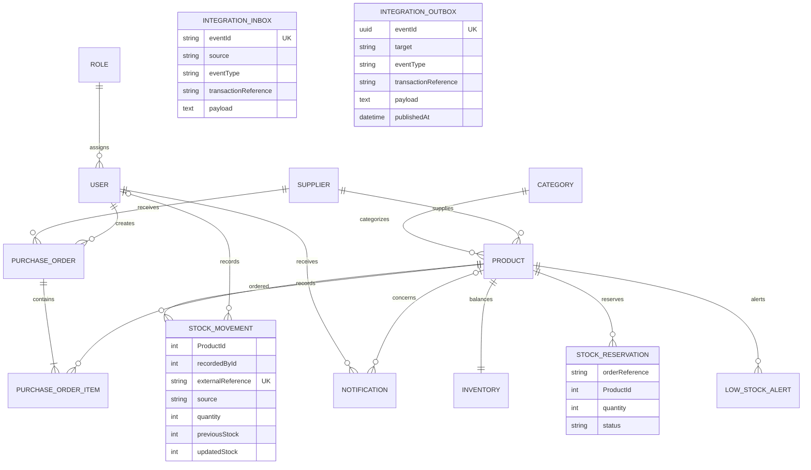
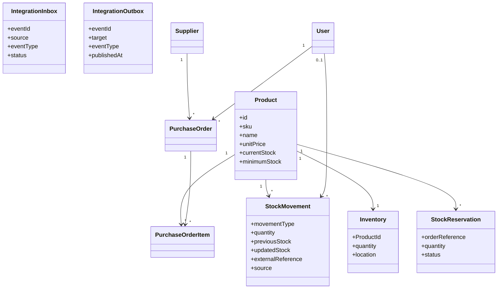

# Inventory architecture

The application uses the existing XianFire conventions: Express routes and middleware, Sequelize models backed by MySQL, and Handlebars-compatible `.xian` views.

## Deployment / integration context

CRM and Accounting remain separate systems. Inventory does not own customer orders, payable balances, or general-ledger entries.

## Entity relationship diagram

`Inventory.quantity` is the physical on-hand balance. Active `StockReservation` quantities are subtracted to compute available stock. Every physical quantity change updates the inventory and product balance and inserts an immutable stock movement within one transaction. External movements carry unique references to prevent replayed deductions.

## Core class / model relationships

